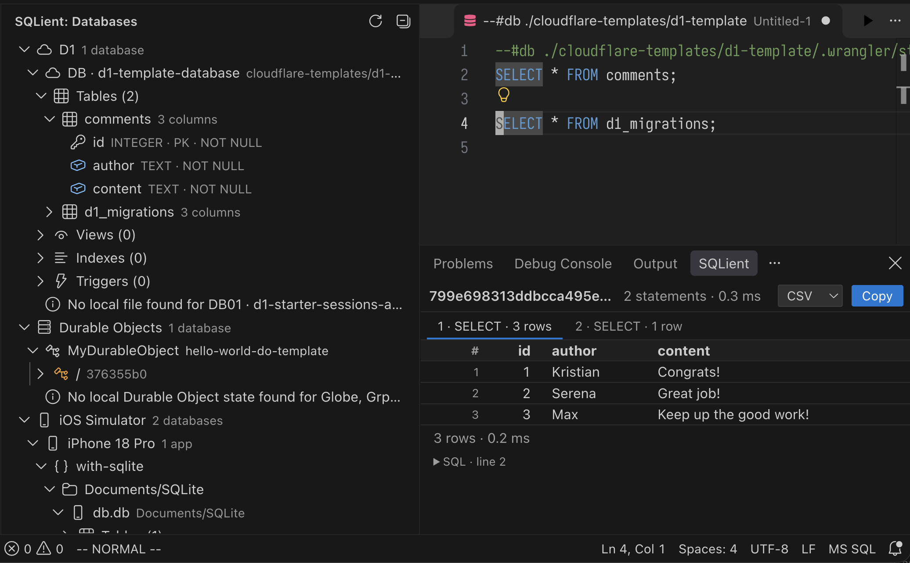

# SQLient

An SQLite workbench for VS Code, tailored for Cloudflare and mobile development.



SQLient finds the databases that belong to your project — local Cloudflare D1, Durable
Object SQLite stores, iOS simulator databases — and lets you query them immediately. No
path hunting, no connection forms. Point it at your project and start writing SQL.

There is no embedded SQL editor here. Queries run in the plain VS Code editor you already
use, so keybindings, snippets, multi-cursor, formatting, and themes keep working. Run the
selection or the whole buffer, and read the results in a table in the Panel.

Why you'll like it:

- Finds D1, Durable Object, and iOS simulator databases automatically.
- Runs saved files or unsaved buffers; a selection runs just the selection.
- One tab per statement, with CSV, JSON, and TSV copy.
- Schema explorer for tables, views, indexes, triggers, and columns.
- One click generates a SELECT, CREATE, or DROP query for any object.

## Install

Install **SQLient** from the VS Code Extensions view (search for `SQLient`), or run
**Extensions: Install from VSIX...** on a packaged `.vsix`.

## Requirements

- VS Code **1.146** or newer, which includes the Node.js 24 built-in SQLite runtime
  (`node:sqlite`).
- No native modules, external SQLite library, or build tools are required.
- iOS simulator discovery requires macOS with Xcode's `simctl`; everything else is
  cross-platform.

## Quick start

1. Open a file whose language mode is **SQL** (plain text will not work).
2. Attach a database with the **SQLient: Browse for database file...** command, or write the
   directive yourself in the first ten lines of the buffer:

   ```sql
   --#db ./assets/my_db.sqlite
   select * from users;
   ```

   Relative paths are resolved against the project (workspace) folder; `~/` is expanded and
   absolute paths are accepted. A path that does not exist yet is created on the first run,
   like `sqlite3 new.db`.

3. Run **SQLient: Run Query** from the Command Palette or the play button in the editor
   title. If text is selected, only the selection runs; otherwise the whole buffer runs.

Without a `--#db` directive, queries run against an in-memory database that lives as long as
that SQL editor tab. Changes from one run are visible to the next.

Multiple statements execute in order and stop at the first error. Each statement gets its
own tab in the **SQLient → Results** panel. The default row limit is 1000 rows per
statement.

## Result panel

- Sticky, bold headers aligned with their column data (numeric columns right-aligned), row
  numbers, dim italic `NULL`, `BLOB (n bytes)` cells, and duplicate columns distinguished
  as `name`, `name#2`.
- Copy the active result as **CSV**, **JSON**, or **TSV** from the toolbar.
- Errors show the SQLite message, the statement index, and the source line.
- The SQL that produced a result is available under the "SQL · line N" disclosure.

## Object explorer

The SQLient activity bar view lists databases associated with the workspace and opens them
as a schema tree. Discovery runs automatically and refreshes on demand.

- **Cloudflare D1**: local databases under
  `.wrangler/state/v3/d1/miniflare-D1DatabaseObject` and
  `.cloudflare/state/v3/d1/miniflare-D1DatabaseObject`. Bindings are read from
  `wrangler.json`/`wrangler.jsonc`; local filenames are derived from `database_id` using the
  same Durable Object id algorithm Miniflare uses. Duplicate files are shown once, preferring
  the newest copy; unmatched local files remain reachable as `D1 · <hash>`.
- **Durable Objects**: local SQLite stores under
  `.wrangler/state/v3/do/<worker>-<class>/<object-id>.sqlite` (and `.cloudflare`
  equivalents), grouped by class. Object names are read from Miniflare's
  `__miniflare_do_name` table when available; otherwise the object id is shown.
- **iOS Simulator**: bundle identifiers are read from each `project.pbxproj` in the
  workspace, then only the matching app's containers on **booted** simulators are scanned
  for SQLite files (app data and app groups). Databases are grouped by simulator device,
  then app, then folder under `Library/Application Support`; each database node shows its
  location in muted text. Shutdown devices are ignored because their containers are stale
  and multiply the scan cost.
- Expanding a database shows Tables, Views, Indexes, and Triggers, then columns with type,
  primary key, NOT NULL, and default metadata. Files are opened read-only, with a snapshot
  fallback when a database cannot be opened in place (for example while a local worker holds
  it).
- Every table, view, index, and trigger node has **New CREATE query** and **New DROP query**
  actions (inline buttons and right-click menu). CREATE opens the stored definition with
  `IF NOT EXISTS`; DROP opens `DROP ... IF EXISTS "<name>";`. Tables also have **New SELECT
  query**, which opens a `SELECT` listing the table's visible columns.
- Each database node and each **Tables** section node has a **New query** action that opens
  an empty SQL editor containing only the `--#db` directive.
- Left-clicking a node name performs no action; use the inline buttons or the right-click
  menu. Existing buffers are never modified.
- Use `sqlient.persistPaths` for custom `--persist-to` directories. **Refresh Databases**
  clears the discovery cache; workspace D1 state changes are also watched.

## Settings

| Setting | Default | Description |
| --- | --- | --- |
| `sqlient.maxRows` | `1000` | Maximum rows fetched per statement. |
| `sqlient.readOnly` | `false` | Open database files read-only. |
| `sqlient.persistPaths` | `[]` | Extra Wrangler persist roots for D1 and Durable Objects, absolute or relative to each workspace folder. |

## Known limitations

- Query parameters (`?`, `:name`, `@name`, `$name`) are not supported yet; inline the values.
- Statements execute synchronously in the extension host. The row cap keeps rendering cheap,
  but a long-running scan cannot be cancelled.
- Encrypted database formats (SQLCipher, the sqleet encryption extension) are not supported.
- Cloudflare discovery (D1 and Durable Objects) reads `wrangler.json`/`wrangler.jsonc`;
  `wrangler.toml` is not parsed.
- iOS discovery requires macOS, Xcode's `simctl`, and a booted simulator with the app
  installed.
- Inline cell editing, a schema explorer beyond the tree, and saved connection lists are out
  of scope.

## Development

```sh
npm install
npm run build              # bundle src/extension.ts to dist/extension.js
npm run watch              # rebuild on change
npm run check              # typecheck + unit tests
npm run test:harness       # run the built bundle against a mocked VS Code API
npm run test:integration   # launch an extension host (needs a desktop session)
npm run package            # produce a .vsix with vsce
```

Press `F5` in VS Code to launch the Extension Development Host.
